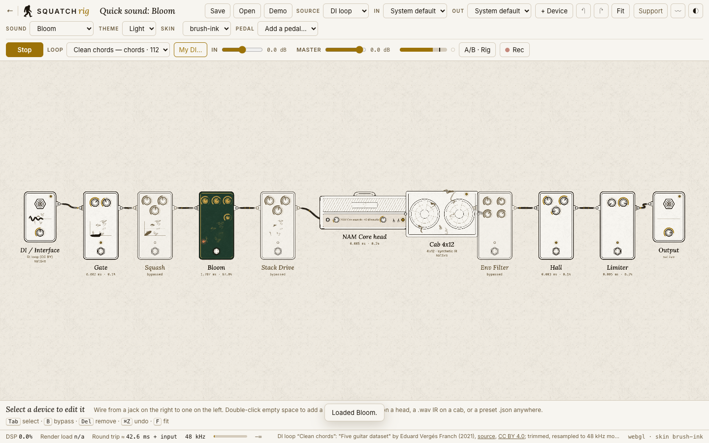

# squatch-rig

A guitar rig that runs in a browser tab. Neural Amp Modeler (NAM) amp models compiled to WebAssembly, and a chain of
effects written as AudioWorklets, run live. You edit the rig as a node graph on a canvas: drag a device in, wire its
jacks, split into parallel paths, bypass something, turn a knob. The whole rig is saved as one JSON document.



Dark theme: [docs/screens/rig-dark.png](docs/screens/rig-dark.png). Phone: [docs/screens/rig-phone.png](docs/screens/rig-phone.png).

## What is in it

- **Amp models:** NAM Core (the open-source NAM engine) built to a single standalone `.wasm` file, one instance shared
  by every amp node. Two MIT example models from the NAM Core project are bundled.
- **Effects, all in `web/worklets/dsp/`:** gate, compressor, an overdrive (the Trail OD), Bloom (a pick-sensitive
  pedal of our own), envelope filter, reverb, limiter and a generated cab. Each is a plain JavaScript module that the
  unit tests run in Node, the same code the worklet runs.
- **Four quick sounds**, a level-matched dry/processed A/B button, a transport with DI loops, live input from an
  audio interface, and a recorder.
- **An offline renderer** (`tools/render.mjs`) that runs the same graph without a browser, deterministically.

## Engines

- The default engine is **stock NAM Core**, built from a pinned upstream commit with nothing added (`nam.wasm`).
- **Experimental** (`nam-experimental.wasm`) is the same build plus `wasm/experimental-fast.patch`, an extra fast path for
  one shape of model. It is a separate file that the page loads only when you choose Experimental.
- No build output is committed. GitHub Actions builds both files from `wasm/PINS` and attests them.
- `tools/public-guard.mjs` reads every file of a tree to be published, binaries included, and CI runs it with the wasm
  files in place. Its self-test plants a failure and must catch it.

## Run it

```sh
npm ci --ignore-scripts     # PixiJS is vendored in web/vendor; this installs the checkers only
wasm/ci-build.sh build/wasm-out build/wasm-work   # builds both wasm files (needs git and python3; it fetches the pinned emsdk)
mkdir -p web/wasm && cp build/wasm-out/*.wasm web/wasm/
npm run serve               # static server on 127.0.0.1:7491, no build step for the page itself
```

Open `http://127.0.0.1:7491/` (loopback counts as a secure context, which AudioWorklet and `getUserMedia` need).
Press Play, or Space. To play through an interface, set Source to Interface. The browser asks for the microphone once,
with echo cancellation, noise suppression and automatic gain control all off.

## Tests

```sh
npm test      # node --test tests/*.test.mjs
```

Last run on this tree, 2026-10-16, with the CI-built wasm files in `web/wasm/`: **90 tests, 87 pass, 0 fail, 3 skipped**.
The skips, each printing its reason:

- two "NAM wasm matches native render" tests skip unless the native reference renderer has been built
  (`native render not built`);
- one test that checks the vendored skin files against a hash list (`VENDOR.json`) skips, because that file is not shipped
  (`VENDOR.json and tools/vendor-skin.mjs are not in the public tree`).

The demo rig uses the bundled NAM Core examples, and the parity tests run on whatever `.nam` files are in `web/models/`.
Browser checks (`npm run test:browser`, `test:skin`, `test:picker`, `test:release`, `test:head`) need Chrome and are
not part of CI.

## What is measured, and what is not

Every number below was measured, with the date and the build it came from. Nothing here is a claim from memory.

**DSP unit tests** (`tests/dsp.test.mjs`, re-run 2026-10-16; the report is written to `tests/out/dsp-report.json`):

| device | result |
|---|---|
| Compressor | steady-state gain reduction within 0.16 dB of theory at ratios 2, 4 and 8 and inputs of -18, -12 and -6 dB (for example 13.36 dB measured against 13.5 dB) |
| Overdrive, symmetric clip | 2nd harmonic at -277 dB (numerically zero), 3rd at -11.8 dB below the fundamental |
| Overdrive, asymmetric clip | 2nd harmonic at -34.4 dB |
| Overdrive, small-signal gain | 12.1 dB at 100 Hz, 26.5 dB at 1 kHz, 16.6 dB at 8 kHz |
| Overdrive, aliasing (3 kHz sine at -6 dBFS, inharmonic over harmonic power below 20 kHz) | drive 0.5: -23.4 dB at 1x, -49.8 dB at 4x oversampling; full drive: -21.5 dB and -36.3 dB |
| Envelope filter | cutoff 310 Hz on a quiet input, 3000 Hz on a loud one; covers 90% of the span 1.3 ms after the step |
| Reverb RT60 (settings of 1, 2.5 and 5 s) | 0.95, 2.33 and 4.59 s |
| Gate | -70 dB hiss attenuated by 70 dB; a -20 dB sine passes unchanged |
| Limiter | output peak -1.000 dBFS at a -1 dBFS ceiling; 95 samples of look-ahead |

**NAM in WebAssembly**

- Several models in one shared wasm instance give bit-identical output to separate instances (a test in this
  tree; passes on the CI-built `nam.wasm`).
- Against the native NAM renderer, maximum absolute sample difference on the bundled examples was 2.1e-7 (the A2
  example) and 1.2e-5 (the A1 example), with output peaks of 0.08 to 0.5. This was measured in 2026-10. The parity test in this tree (`tests/nam-parity.test.mjs`, limit 1e-4)
  repeats it when you build the native renderer; **it has not been re-run against the current CI-built file**, and
  the CI does not build the native renderer.
- CPU per 128-frame render quantum (budget 2667 µs at 48 kHz), `tools/bench-nam.mjs`, best of 9, Node/V8 on an
  M1 Max that was busy (load average about 34, so these are pessimistic), the CI-built files, 2026-10-16:

  | model | `nam.wasm` (default) | `nam-experimental.wasm` |
  |---|---|---|
  | NAM Core A2 example | 198.5 µs, 7.4% of the budget, 13.4x realtime | 203.3 µs, 7.6% |
  | NAM Core A1 example | 515.4 µs, 19.3%, 5.2x realtime | 517.5 µs, 19.4% |

  On these two models the experimental build is no faster. It is for model shapes we do not bundle.
- File sizes of the CI builds: `nam.wasm` 629,311 bytes, `nam-experimental.wasm` 815,081 bytes.

**Latency.** The algorithmic latency on the public demo's longest path is 3.3 ms: two oversampled overdrives at
32 samples each, plus the limiter's 95 samples. That is arithmetic from the code, not a measurement of a device.

**Not measured, so not claimed**

- Round-trip latency on a real audio interface. Everything so far ran in headless Chrome with a fake audio device.
- Safari and Firefox. Only Chrome has pressed Play. The one-heap design and the resume-inside-the-gesture rule are
  there for WebKit and iOS memory limits, but they have not been exercised.
- Anything by ear on the public demo rig: levels, underruns and spectra are checked by measurement.
- A real cabinet: the cab is a synthetic impulse response, a plausible colouring and nothing more.
- Loading a model parses it on the audio thread, so swapping models can glitch for a few quanta (about 30 to 40 ms).
- The preset `meta.signature` field exists but nothing signs or verifies. There is no MIDI, tuner or looper here.

## Layout

```
server.mjs              static server (web/ at /, design/ at /design/)
wasm/                   nam_wasm.cpp (the C ABI), PINS (pinned sources), ci-build.sh, build.sh, experimental-fast.patch
web/                    the app: js/graph (document, types, demo), js/audio (engine), js/ui (canvas, skins),
                        worklets (nam-processor, fx-processor, dsp/*), css, fonts, audio/loops, models, vendor
design/                 skin definitions and the device art the canvas draws
presets/bloom.rig.json  a preset: Bloom into the NAM Core example head
tests/                  node --test suites
tools/                  public-guard, export-public (the static site), export-source (this repository), render,
                        browser checks, bench-nam
.github/workflows/      ci.yml (build both wasm, guard, test, attest) and pages.yml (the demo site)
```

## Builds, attestation, Pages

`ci.yml` builds `nam.wasm` and `nam-experimental.wasm` from `wasm/PINS` (NAM Core at one upstream commit, the pinned
Emscripten), scans the whole tree with the wasm in it, installs with `npm ci --ignore-scripts`, runs the tests, and on
`main` attests both files with GitHub build provenance. `pages.yml` exports the static site from the tracked sources,
adds the CI-built wasm, scans the finished site again, attests and deploys it to GitHub Pages. Actions are pinned to
commit SHAs. Verify a downloaded file with `gh attestation verify nam.wasm --repo Squatch-Stack/squatch-rig`.

## Licences and credits

Code is MIT. The device and brand art listed in `LICENSE` is **All Rights Reserved** and is not under the MIT licence.
Third-party material keeps its own licence:

| what | licence |
|---|---|
| NAM Core (Steven Atkinson and contributors), the engine, and its two bundled example models | MIT (`web/models/LICENSE-NAM-Core-MIT.txt`) |
| Eigen (built into the wasm) and nlohmann/json | MPL-2.0 and MIT |
| PixiJS (`web/vendor/pixi.mjs`) | MIT (`web/vendor/LICENSE-pixi.js.txt`) |
| tiny-lru, bundled inside PixiJS's file (its notice stays in the file's header) | BSD-3-Clause |
| The vendored design-token and skin-validator modules in `web/vendor/squatch-skin/` | MIT, ours (squatch-skin) |
| The Brush skin package, `design/skins/brush/` (faceplate, knob, footswitch and lamp art) | CC BY 4.0, as its own `skin.json` declares; its font is OFL-1.1 |
| The device and brand art (`design/assets/`, `design/skin.brush-ink.json`, `web/img/`, `docs/screens/`) | All Rights Reserved, see `LICENSE` |
| Inter and Lora fonts | SIL OFL 1.1 (`web/fonts/OFL.txt`) |
| DI loops in `web/audio/loops/` | CC BY 4.0 ("Five guitar dataset" by Eduard Vergés Franch, 2021, [Zenodo 10.5281/zenodo.4988354](https://doi.org/10.5281/zenodo.4988354)) or CC0 1.0 for the others, per file; the exact source, credit and licence of each file is in `web/audio/loops/index.json` and shown in the app |
| `web/audio/di-loop.wav` | 12 s excerpts from the same dataset, CC BY 4.0 |

The closest prior art is [tone-3000/neural-amp-modeler-wasm](https://github.com/tone-3000/neural-amp-modeler-wasm)
(MIT), a single-threaded NAM WebAssembly engine in a hand-written AudioWorkletProcessor. We took two of its
lessons, post bytes rather than compiled modules, and keep one heap, and copied none of its code.
