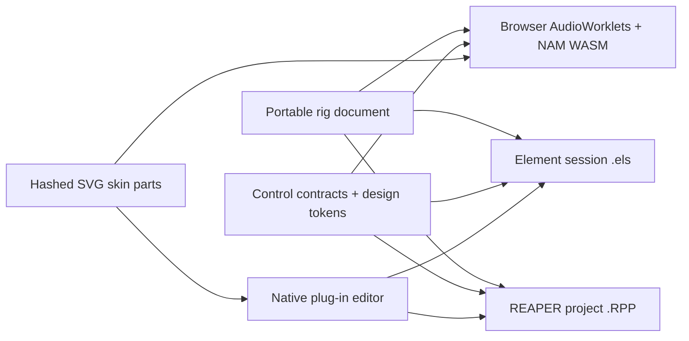

# Squatch Rig across browser, Element and REAPER

## Current proof

The browser rig already has an editable audio graph, three parallel NAM heads,
effects, DI playback, live input, recording, meters and a saved `*.rig.json`
document. Bloom is an original pick-sensitive DSP pedal in that graph. Its
running enclosure and sheaf are SVG geometry driven by theme variables and
signal meters; the photographic concepts are material references, not UI
bitmaps. The attempted Bloom NAM capture is held back because it missed the
held-out acceptance target (the study notes are not published).

The complete Kushview Element source is checked out at `../../element`. The local
build emits `KV-Element-FX.clap`, installed in the user CLAP directory. REAPER
scans it as `Element FX (Kushview)`. A minimal CLAP host independently loaded
the bundle, read the descriptor and audio ports, instantiated it, and started
processing at 48 kHz (`integrations/element/clap-smoke.cpp`). It did not submit
an audio block. The main REAPER
application is proprietary;
`../../reaper-sdk` is its open extension SDK. The starter ReaScript at
`../integrations/reaper/create-element-rig.lua` makes a DI track routed into an
Element FX track. An Element session with NAM and Bloom wired inside it has
not been created or audio-tested yet. Bloom currently runs in the browser,
not as a native CLAP/VST3/LV2 processor.

## One graph, three hosts

The portable document should name nodes, edges, parameter IDs, model/IR hashes,
channels and latency. A renderer resolves those IDs into host-specific plug-ins.
Every export must report unsupported nodes and parameters explicitly. Host
project files are generated artifacts; the portable graph is the editable
source of truth.

Bloom's `../../squatch-skin/contracts/bloom.params.json` now gives stable IDs,
ranges, defaults, bypass polarity and display metadata. Its generated OSCQuery,
LV2, MIDI-CI and WAM descriptors are checked by the skin build. The Browser
skin preview switches Bloom and Trail OD through the same two validated skins.
`npm run contract:build` generates the browser DSP parameter map from this
same descriptor; `npm run contract:check` detects drift. The generated module
is committed so the browser rig still runs without the sibling repository.
The next native processor must expose those exact IDs and ranges through CLAP
and use the same DSP transfer behaviour as the browser implementation before
it can claim preset or sound parity.

## Visual and interaction rules

Use the existing Home flows as navigation precedent: a persistent sidebar,
search before canvas traversal, scoped project/graph selection, compact
status chips, and direct open actions. Keep edit, perform, map and study views
of one rig document. The graph overview is bounded; expanding a node fetches
its neighbours from Ladybug, and source evidence remains pinned to a snapshot.
The performance view foregrounds controls, bypass, levels and clipping while
preserving the same routing graph.

Generated images can explore finish, light and texture on the GPU box. The
runtime UI uses named colour/type/motion tokens and compact SVG paths for the
enclosure, controls and sheaf. Path geometry and meter envelopes are generated
deterministically, so motion can interpolate smoothly at display refresh rate
without reloading an image. Store a raster thumbnail only for catalog/search.
The previous SDXL studies informed the material palette; the SVGDreamer sheaf
trial produced scattered paths and is not a usable rig asset.

For another GPU study, Vector Grimoire supplies a discrete SVG token model,
but its published text-generation checkpoints target simple FIGR-8/MNIST
shapes. OmniSVG targets richer SVGs. Test either as an ideation source against
the existing deterministic sheaf, using path count, 64 px legibility, theme
recolouring, safe SVG lint and interpolation smoothness as acceptance gates.
Model output only enters a skin after it is reduced to named geometry and
tokens. References: [Vector Grimoire](https://github.com/potpov/VectorGrimoire),
[OmniSVG](https://github.com/OmniSVG/OmniSVG).

## Loading and memory

Keep the Ladybug databases and `.nam`/IR assets on disk. Query bounded graph
fragments; maintain a small read-only database-handle cache. Lazy-load only
the active NAM model, current IR and visible artwork. Prewarm a second model
when a user hovers or selects a branch, then release cold models after a
measured idle interval. Meter values are small ring buffers; they do not need
graph snapshots in memory. Audio processing never waits on disk or Cypher:
prepare a model on a worker/control thread and swap it at a block boundary.

## Acceptance gates for the next host milestone

1. A native Bloom processor has parameter, impulse and multirate parity
   against `web/worklets/dsp/bloom.js`, including bypass and reported latency.
2. A portable preset opens in the browser and in Element with the same node
   order, model hashes, control values and channel routing; unsupported
   features appear in an export report.
3. REAPER instantiates Element FX, loads the exported Element session, plays a
   DI fixture and renders an A/B file. Compare output, peak and latency to the
   browser render with a stated numerical tolerance.
4. Skin packages validate hashes, SVG allowlist, layouts and accessibility in
   both light and dark themes. The native editor draws the same controls from
   the contract rather than placing a background screenshot behind knobs.
